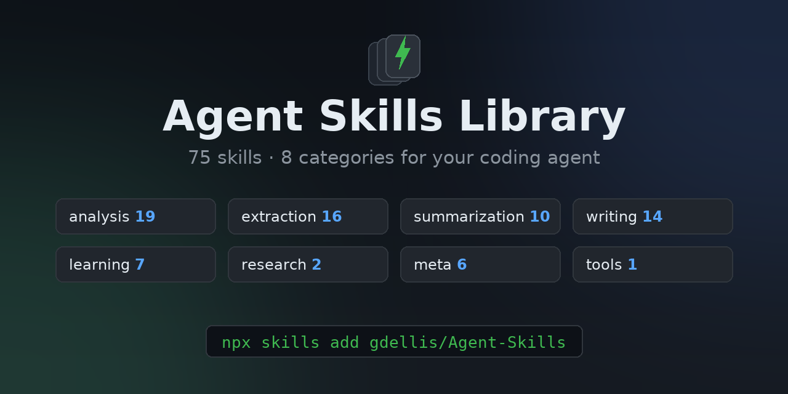

# Agent Skills Library



[](LICENSE)

A snapshot of my personal skills library (75 skills, synced November 14, 2026).

**Where to start:** Using a coding agent (Claude Code, OpenCode, Codex, …) or comfortable in a terminal? Skip ahead to [Installing into a coding agent](#installing-into-a-coding-agent). Otherwise, start with [Using a skill in a chat assistant](#using-a-skill-in-a-chat-assistant-no-coding-required).

## Credits

A large portion of these skills are converted from the [patterns](https://github.com/danielmiessler/Fabric/tree/main/data/patterns) in [Daniel Miessler's Fabric](https://github.com/danielmiessler/Fabric) project. The original pattern definitions are worth a look on their own.

## Structure

Each skill is a folder containing a `SKILL.md` file — the instructions your agent loads when it uses the skill. Some skills also include `references/` files, scripts, or quick-start guides.

Skills live under `skills/<category>/<skill>/` — the catalog layout supported by the [`skills` CLI](https://github.com/vercel-labs/skills), so `npx skills add gdellis/Agent-Skills` discovers them natively. Skill folder names are unchanged; only their location moved.

| Category | Contents |
| --- | --- |
| [`analysis/`](./skills/analysis/) | Analyze and critique content — claims, papers, prose, patents, scripture, arguments, thinking |
| [`extraction/`](./skills/extraction/) | Pull specific things out of content — ideas, insights, references, recipes, predictions |
| [`summarization/`](./skills/summarization/) | Structured summaries of any content — meetings, lectures, papers, newsletters, video |
| [`writing/`](./skills/writing/) | Create and refine written content — essays, emails, tweets, LaTeX, blog posts, stories |
| [`learning/`](./skills/learning/) | Study helpers — flashcards, quizzes, mnemonics, reading plans, explanations |
| [`research/`](./skills/research/) | Source-backed research and multi-source synthesis |
| [`meta/`](./skills/meta/) | Skill creation, prompt structuring, tagging, and other meta tooling |
| [`tools/`](./skills/tools/) | Utility tools — fetching and converting content |

## Using a skill in a chat assistant (no coding required)

Most chat assistants can open web links, so you can hand a skill straight to ChatGPT, Claude, or Gemini. Copy this prompt, swap in the skill you want (the tables below list every path), and paste it into a chat:

````text
Fetch the Agent Skill at this URL and follow it for the rest of this conversation:

https://raw.githubusercontent.com/gdellis/Agent-Skills/main/skills/<category>/<skill>/SKILL.md

For example: https://raw.githubusercontent.com/gdellis/Agent-Skills/main/skills/summarization/summarize/SKILL.md

If you can't open URLs, say so and I'll paste the skill's contents instead.
````

If the assistant can't open URLs, open the skill's raw `SKILL.md` in your browser (click a skill in the tables below, then its `SKILL.md`), copy everything, and paste it after this line instead:

````text
Follow these skill instructions for the rest of this conversation:
````

To make a skill stick around instead of pasting it every time:

- **Claude** — Customize → Skills → **+** → Create → upload a ZIP containing the skill folder (with `SKILL.md` at the ZIP's root). Or paste the skill text into a Project's instructions.
- **ChatGPT** — if your plan offers Skills (Plugins → Skills → Create → Upload), upload the ZIP there; otherwise paste the skill text into a Project's instructions or your custom instructions.
- **Gemini** — Skills → Create → paste the skill's name, description, and instructions from its `SKILL.md`.

To get the files onto your computer: click **Code → Download ZIP** at the top of this repository, unzip it, and compress just the one skill folder you want (e.g. `skills/summarization/summarize/`) into a new ZIP.

Notes:

- The prose-style skills (analysis, extraction, summarization, writing, learning, research, most of meta) work well in chat. `tools/` expects a coding agent with a file system and won't do much in a plain chat.
- Chat assistants apply skills as instructions, not as runnable code — skills that rely on scripts or a Python environment won't execute there.

## Installing into a coding agent

These folders follow the open [Agent Skills](https://agentskills.io) standard, so they work with any compatible agent.

### Option 1: `npx skills` CLI (recommended)

The [`skills`](https://github.com/vercel-labs/skills) CLI (requires Node.js 22.20+) installs skills into whichever coding agents you use. Run it from your project:

```bash
npx skills add gdellis/Agent-Skills
```

You'll be asked which skills to install and for which agents. Skills install into the current project by default; add `-g` to make them available across all your projects.

Useful variants:

```bash
# List everything in the repo without installing
npx skills add gdellis/Agent-Skills --list

# Install one skill for one agent
npx skills add gdellis/Agent-Skills --skill summarize -a claude-code

# Install everything, everywhere, no prompts
npx skills add gdellis/Agent-Skills --all

# Install one skill globally (all projects) for Claude Code and OpenCode
npx skills add gdellis/Agent-Skills --skill improve-writing -g -a claude-code -a opencode

# Install from a direct path to a single skill in the repo
npx skills add https://github.com/gdellis/Agent-Skills/tree/main/skills/summarization/summarize
```

Other handy commands: `npx skills list` (what is installed), `npx skills check` (look for updates), `npx skills update`, `npx skills remove`.

### Option 2: Manual install

Clone the repo and copy (or symlink) the skill folders you want into your agent's skills directory:

```bash
git clone git@github.com:gdellis/Agent-Skills.git
mkdir -p .claude/skills
cp -r Agent-Skills/skills/summarization/summarize .claude/skills/
# or, to keep them linked to the repo:
ln -s "$(pwd)/Agent-Skills/skills/summarization/summarize" .claude/skills/summarize
```

Skill folder locations for common agents:

| Agent | Project path | Global path |
| --- | --- | --- |
| Claude Code | `.claude/skills/` | `~/.claude/skills/` |
| OpenCode | `.agents/skills/` | `~/.config/opencode/skills/` |
| Codex | `.agents/skills/` | `~/.agents/skills/` |
| Pi | `.agents/skills/` | `~/.agents/skills/` |
| Cursor | `.agents/skills/` | `~/.cursor/skills/` |
| Gemini CLI | `.agents/skills/` | `~/.gemini/skills/` |
| GitHub Copilot | `.agents/skills/` | `~/.copilot/skills/` |
| Windsurf | `.windsurf/skills/` | `~/.codeium/windsurf/skills/` |

The CLI supports 75+ agents in total; see its [supported agents list](https://github.com/vercel-labs/skills/blob/main/docs/agents.md).

### Portability note

All remaining skills are plain markdown that works in any compatible coding agent.

## Notes


## Skills

### `analysis/` — Analyze claims, papers, prose, patents, scripture, and thinking — critique, fact-check, and evaluate content.

| Skill | Description |
| --- | --- |
| [`analyze-claims`](./skills/analysis/analyze-claims/) | Load this when you want the truth claims in a piece of content analyzed and rated — for each claim, supporting evidence, counter-evidence, fallacies commit... |
| [`analyze-paper`](./skills/analysis/analyze-paper/) | Load this when you share a research paper and want a critical analysis of its scientific rigor and quality — findings, study quality breakdown (design, sa... |
| [`analyze-patent`](./skills/analysis/analyze-patent/) | Load this when you share a patent application and want an examiner-style analysis — field, problem, solution, advantages, novelty and inventive-step asses... |
| [`analyze-prose`](./skills/analysis/analyze-prose/) | Load this when you share a piece of writing and want an expert evaluation of its quality — letter grades (A–F) for novelty, clarity, and prose, improvemen... |
| [`analyze-prose-pinker`](./skills/analysis/analyze-prose-pinker/) | Load this when you share prose and want it critiqued according to Steven Pinker's The Sense of Style — style analysis, positive and critical assessments w... |
| [`analyze-scripture`](./skills/analysis/analyze-scripture/) | Load this when you share a scripture passage (biblical or LDS-specific) and want structured study notes — passage identification, key insights and doctrin... |
| [`capture-thinkers-work`](./skills/analysis/capture-thinkers-work/) | Load this when you name a philosopher, notable figure, thinker, writer, author, or philosophy and want a structured profile of what they/it taught — encap... |
| [`challenge-my-thinking`](./skills/analysis/challenge-my-thinking/) | Use this when you want to pressure-test your thinking. |
| [`check-falsifiability`](./skills/analysis/check-falsifiability/) | Load this when you want to know whether a claim, definition, framework, or argument is falsifiable — can it be proven wrong? |
| [`deconstructive-lens`](./skills/analysis/deconstructive-lens/) | Use this when you share a text and want a Derridean or post-structuralist close reading that reveals the text's architecture — binary oppositions, hierarc... |
| [`detect-mind-virus`](./skills/analysis/detect-mind-virus/) | Load this when you want content, proposals, ideologies, or arguments checked for manipulative reasoning patterns — ideas that spread via fear, guilt, ident... |
| [`dialog-with-socrates`](./skills/analysis/dialog-with-socrates/) | Use this when you want a Socratic dialogue — having your beliefs examined through probing questions rather than receiving direct answers. |
| [`document-review`](./skills/analysis/document-review/) | Use this when you want to review documents for completeness, compliance, consistency, or quality. |
| [`find-hidden-message`](./skills/analysis/find-hidden-message/) | Use this when you share a political speech, article, advertisement, or message and want a cynical analysis of its overt versus hidden political messages. |
| [`find-logical-fallacies`](./skills/analysis/find-logical-fallacies/) | Load this when you share an argument, article, or piece of text and want all the logical fallacies in it identified and named — each with its type and an... |
| [`get-wow-per-minute`](./skills/analysis/get-wow-per-minute/) | Load this when you want to know the "wow-factor density" of content — a 0-10 score per minute for surprise, novelty, insight, value, and wisdom, plus an ov... |
| [`job-interview-feedback`](./skills/analysis/job-interview-feedback/) | Load this when you share a job interview transcript or recording and want structured, actionable feedback on your performance — strengths, areas for impr... |
| [`judge-ultimate-law`](./skills/analysis/judge-ultimate-law/) | Use this when you present a scenario or dispute and want verdicts derived strictly from the Ultimate Law rulebook — a pure, rule-by-rule logical derivatio... |
| [`sherlock-freud-mind-model`](./skills/analysis/sherlock-freud-mind-model/) | Use this when you share text or dialogue produced by or about a person and want an evidence-based psychological model of that subject — personality struct... |

### `extraction/` — Pull specific things (ideas, insights, references, recipes, predictions…) out of content.

| Skill | Description |
| --- | --- |
| [`extract-book-insights`](./skills/extraction/extract-book-insights/) | Load this when you give a book name and want its most important content pulled out — 50-100 of its most surprising and interesting ideas, or 50-100 of its... |
| [`extract-ideas`](./skills/extraction/extract-ideas/) | Load this when you want a comprehensive list of ALL the ideas in a piece of content, without ranking or filtering — every idea captured as a short bullet p... |
| [`extract-insights`](./skills/extraction/extract-insights/) | Load this when you want the most surprising, powerful, and novel insights from content — the top 10, ranked by surprise and importance, written as 8-word b... |
| [`extract-main-idea`](./skills/extraction/extract-main-idea/) | Load this when you want the single primary idea extracted from any content — a 15-word main idea plus a 15-word recommendation. |
| [`extract-most-redeeming-thing`](./skills/extraction/extract-most-redeeming-thing/) | Load this when you want the single most redeeming thing about a person, body of work, or content extracted — even if they're mostly horrible. |
| [`extract-patterns`](./skills/extraction/extract-patterns/) | Load this when you have a collection of ideas, data, or observations and want the recurring, surprising patterns found — where the same idea kept coming up... |
| [`extract-predictions`](./skills/extraction/extract-predictions/) | Load this when you want all the predictions made in a piece of content extracted — each prediction with its date, confidence level, and how to verify it, p... |
| [`extract-primary-problem-solution`](./skills/extraction/extract-primary-problem-solution/) | Load this when you want a single sentence articulating what an author or body of work believes is the primary problem with the world — or the primary solut... |
| [`extract-questions`](./skills/extraction/extract-questions/) | Load this when you want all the questions asked by an interviewer in a conversation extracted word-for-word — from podcasts, 1-on-1 interviews, or multi-pa... |
| [`extract-recipe`](./skills/extraction/extract-recipe/) | Load this when you share cooking content and want the recipe extracted — a short description (difficulty, spiciness, time), ingredients with measurements,... |
| [`extract-recommendations`](./skills/extraction/extract-recommendations/) | Load this when you want the concise, practical recommendations extracted from a piece of content — those explicitly made or that naturally flow from it, up... |
| [`extract-references`](./skills/extraction/extract-references/) | Load this when you want all the references in a piece of content listed — books, papers, art, stories, literature, and other sources of learning that were... |
| [`extract-skills`](./skills/extraction/extract-skills/) | Load this when you have a job description and want all the skills extracted and classified — output as a two-column table of skill name and hard/soft type. |
| [`extract-song-meaning`](./skills/extraction/extract-song-meaning/) | Load this when you give a song name, lyrics, or other information about a song and want to know what the song means — a summary sentence, the meaning in d... |
| [`extract-video-instructions`](./skills/extraction/extract-video-instructions/) | Load this when you share a video (uploaded file or link) and want clear, actionable, step-by-step written instructions extracted from it — e.g.… |
| [`extract-wisdom`](./skills/extraction/extract-wisdom/) | Load this when you share content (podcast, talk, article, interview) and want the surprising, insightful, and interesting material extracted — ideas, insi... |

### `summarization/` — Summaries of content of any kind — articles, meetings, lectures, debates, newsletters, papers, videos.

| Skill | Description |
| --- | --- |
| [`summarize`](./skills/summarization/summarize/) | Load this when you share content of any kind and want a structured Markdown summary — a one-sentence summary, the 10 most important points, and the 5 best... |
| [`summarize-debate`](./skills/summarization/summarize-debate/) | Load this when you share a debate or discussion transcript and want a super concise summary of where the parties disagree, the arguments each side makes,... |
| [`summarize-git-changes`](./skills/summarization/summarize-git-changes/) | Load this when you want git activity summarized — a changelog-style update from recent repo changes, a conventional commit message from a diff, or a summar... |
| [`summarize-lecture`](./skills/summarization/summarize-lecture/) | Load this when you have a lecture or long-video transcript and want a structured summary with topic headlines, definitions, timestamps for each topic, tools... |
| [`summarize-legislation`](./skills/summarization/summarize-legislation/) | Load this when you share a political proposal, bill, or piece of legislation and want an unbiased summary — key points, proposed changes, plus the positiv... |
| [`summarize-meeting`](./skills/summarization/summarize-meeting/) | Load this when you have a meeting transcript and want structured meeting notes — overview, key points, tasks, decisions, challenges, timeline, references, a... |
| [`summarize-micro`](./skills/summarization/summarize-micro/) | Load this when you want an ultra-short summary of any content — a micro version with one-sentence summary, 3 main points, and 3 takeaways, each in 12 words... |
| [`summarize-newsletter`](./skills/summarization/summarize-newsletter/) | Load this when you receive a newsletter and want the most meaningful and useful content extracted from it — summary, key content, opinions, tools, compani... |
| [`summarize-paper`](./skills/summarization/summarize-paper/) | Load this when you provide an academic paper's full text and want a structured summary of its technical approach — goal, methodology, distinctive features... |
| [`youtube-summary`](./skills/summarization/youtube-summary/) | Load this when you have a YouTube video transcript and want a concise, structured summary with headings and [HH:MM:SS] timestamps for key points, ending wit... |

### `writing/` — Create, refine, and reshape written content — essays, emails, tweets, LaTeX, blog posts, stories.

| Skill | Description |
| --- | --- |
| [`create-aphorisms`](./skills/writing/create-aphorisms/) | Load this when you give a topic and want a list of 20 real, known aphorisms about it — each attributed to the real person who said it. |
| [`create-golden-rules`](./skills/writing/create-golden-rules/) | Load this when you have a codebase, documentation, or set of team practices and want the implicit rules extracted into clear, enforceable "golden rules" — w... |
| [`create-story`](./skills/writing/create-story/) | Load this when you provide a psychological profile (or profiles) of one or two people — real or fictional, traits, fears, motivations, background — and wan... |
| [`create-story-explanation`](./skills/writing/create-story-explanation/) | Load this when you have complex content (a paper, talk, article, interview) and want it transformed into a short, conversational, story-like narrative summa... |
| [`doc-coauthoring`](./skills/writing/doc-coauthoring/) | Walk through a structured workflow for co-authoring documentation. |
| [`enrich-blog-post`](./skills/writing/enrich-blog-post/) | Load this when you have a Markdown blog post that needs enriching for static-site rendering — fixing formatting and structure, and turning ❝ symbols or NOTE-... |
| [`humanize-writing`](./skills/writing/humanize-writing/) | Load this when you have AI-generated (or AI-sounding) text and want it rewritten to sound natural and conversational, like a real person wrote it — short se... |
| [`improve-academic-writing`](./skills/writing/improve-academic-writing/) | Load this when you provide text that needs to be refined into professional academic or scientific writing — formal, clear, easy to understand, free of word... |
| [`improve-writing`](./skills/writing/improve-writing/) | Load this when you provide text (any language) and want it refined and improved for clarity, coherence, grammar, and style — without changing its meaning. |
| [`proofread-text`](./skills/writing/proofread-text/) | Load this when you want text proofread and cleaned up — fixing typos, spelling, punctuation, grammar, and broken formatting (weird line breaks, missing cap... |
| [`write-essay`](./skills/writing/write-essay/) | Load this when you want a clear, illuminating essay written on a topic — in the style of a named author (defaults to Paul Graham's concise, simple style),... |
| [`write-formal-email`](./skills/writing/write-formal-email/) | Load this when you want to write or respond to a formal or professional email — polished, concise, properly formatted business correspondence with greeting... |
| [`write-latex`](./skills/writing/write-latex/) | Load this when you want a LaTeX document created — a complete, syntactically correct .tex file (preamble, document body, proper environments) that compiles... |
| [`write-tweet`](./skills/writing/write-tweet/) | Load this when you want content turned into an engaging tweet — a concise, punchy message within the 280-character limit, in plain simple language, with sp... |

### `learning/` — Study tools — flashcards, quizzes, mnemonics, reading plans, and explanations.

| Skill | Description |
| --- | --- |
| [`create-flash-cards`](./skills/learning/create-flash-cards/) | Load this when you have study material and want flashcards created from its key concepts — as Markdown flashcards, or as Anki-ready CSV cards following the... |
| [`create-mnemonic-phrases`](./skills/learning/create-mnemonic-phrases/) | Load this when you give a list of words and want memorable mnemonic sentences — the words kept in exact order and spelling, bolded, embedded in five short... |
| [`create-quiz`](./skills/learning/create-quiz/) | Load this when you provide learning objectives and want review questions generated — up to three challenging questions per objective, with answers, adapte... |
| [`create-reading-plan`](./skills/learning/create-reading-plan/) | Load this when you give an author name or topic and want a three-phase reading plan — core, extended, and exploratory books (plus articles/essays), each w... |
| [`explain-docs`](./skills/learning/explain-docs/) | Load this when you have documentation or instructions for a tool and want better instructions generated — an overview of what it does and why people use it,... |
| [`explain-math`](./skills/learning/explain-math/) | Load this when you provide mathematical equations or concepts and want them explained in easy-to-understand terms — step-by-step problem solving, techniqu... |
| [`explain-terms`](./skills/learning/explain-terms/) | Load this when you have content with advanced or obscure terms and want a glossary — each term with a 2-sentence definition, an analogy, and why it matters. |

### `research/` — Source-backed research and multi-source synthesis.

| Skill | Description |
| --- | --- |
| [`deep-research`](./skills/research/deep-research/) | Use this when you ask for thorough research, source-backed synthesis, market or technical landscape analysis, or an evidence-based brief. |
| [`research-synthesis`](./skills/research/research-synthesis/) | Use this when you have multiple sources, notes, files, or search results and want them synthesized into a structured brief, comparison, or recommendation. |

### `meta/` — Skill creation, prompt structure, tagging, and other meta tooling.

| Skill | Description |
| --- | --- |
| [`convert-to-markdown`](./skills/meta/convert-to-markdown/) | Load this when you have content in another format (HTML page, pasted article, export, messy text) and want it converted to clean Markdown — a complete, fait... |
| [`create-fabric-pattern`](./skills/meta/create-fabric-pattern/) | Load this when you want to create a new Fabric pattern from a description of what you want to accomplish (e.g.… |
| [`create-tags`](./skills/meta/create-tags/) | Load this when you want tags/keywords extracted from text content, e.g.… |
| [`infographic-outline-creator`](./skills/meta/infographic-outline-creator/) | Create infographic outlines and visual content structures. |
| [`skill-creator`](./skills/meta/skill-creator/) | Load this before creating, updating, or deleting Skills, or whenever you plan to modify your own Skill files under skills/. |
| [`structure-prompt`](./skills/meta/structure-prompt/) | Load this when you want to convert rough input, a task description, or an idea into a well-structured, production-ready AI prompt with IDENTITY, STEPS, OUT... |

### `tools/` — Utility tools — fetching and converting content.

| Skill | Description |
| --- | --- |
| [`youtube-transcript`](./skills/tools/youtube-transcript/) | Load this when you want to extract, download, or generate a transcript from a YouTube video (captions, subtitles, or a full text transcript with or without... |
