# Diagram Canvases

Load this reference only when producing Mermaid or raw SVG. It is not a report
outline and does not require a fixed number or order of diagrams.

## Mermaid Output

- In a `mermaid` Canvas, write raw Mermaid source only.
- In Markdown, put each complete diagram in its own fenced `mermaid` block.
  Keep headings, captions, and explanations outside the fence.
- Use Mermaid for structural diagrams. For quantitative charts, use only the
  vetted templates below: `xychart-beta` for bar or line charts, `pie` for
  proportions, and `quadrantChart` for quadrant matrices. For unsupported types
  such as scatter plots or histograms, prefer the rich-ui data-visualization workflow or
  executable plotting code.
- For generic requests, prefer `flowchart`, `sequenceDiagram`, `classDiagram`,
  `stateDiagram-v2`, `erDiagram`, `gantt`, `journey`, `mindmap`, or `timeline`.
- Use beta or specialized families only when the user names one, clearly needs
  its semantics, or asks for exhaustive Mermaid coverage.
- Requests to be creative, novel, or surprising apply to the report's content,
  insights, and composition. They do not justify experimental diagram syntax.
- Keep each block within one grammar. The first non-empty source line after an
  optional init directive must be the diagram declaration.
- Declarations, keywords, C4 functions, IDs, and aliases are case-sensitive.
- Keep labels short. Declare identifiers before referencing them. Use simple
  identifier-shaped IDs and put punctuation or prose in quoted labels.
- Never put a theme directive, `style`, `classDef`, edge, node, title, or data
  statement in a Mermaid fence without a complete diagram.
- Put one statement per line. `A[Start] B[End]` is an error; write each node
  or edge on its own line.

## Specialized Declarations

Other documented declarations include:

- `sankey-beta`, `requirementDiagram`, and `gitGraph`.
- `C4Context`, `C4Container`, `C4Component`, `C4Dynamic`, `C4Deployment`,
  `kanban`, and `block`.
- `treeView-beta`, `packet`, `radar-beta`, `architecture-beta`,
  `eventmodeling`, `ishikawa-beta`, `venn-beta`, `treemap-beta`,
  `wardley-beta`, and `info`.

Do not invent similar declarations. In particular:

- Bar and line series belong inside `xychart`; do not declare `barChart`,
  `lineChart`, or `areaChart`.
- For donut chart requests, use `pie` instead; Mermaid does not support the
  center hole. Do not declare `donut`.
- Do not declare `gauge`, `heatmap`, `packetDiagram`, `tree`, `event`, `radar`,
  `venn`, `ishikawa`, `treemap`, or `wardley`.

## Stable Templates

Adapt labels and content while preserving each template's declaration and
statement shapes.

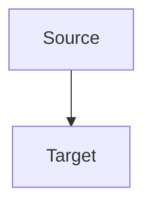

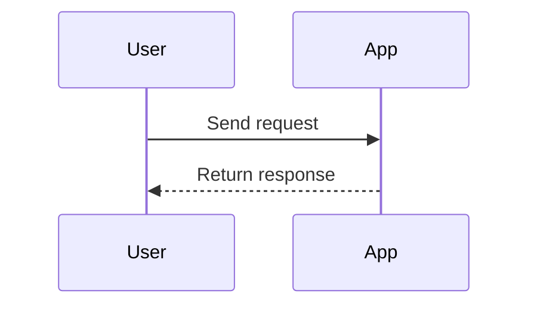

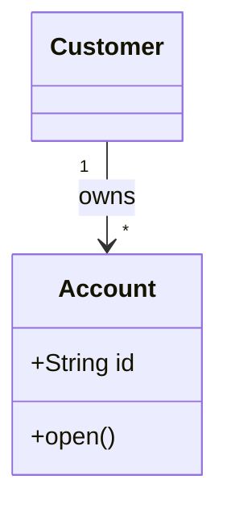

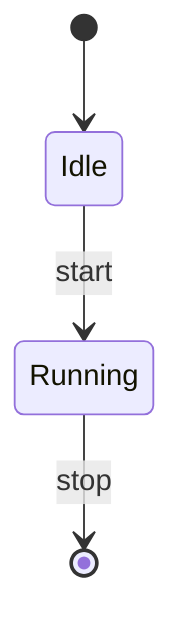

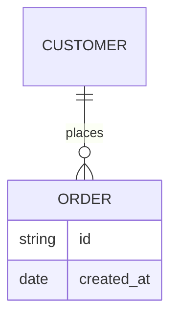

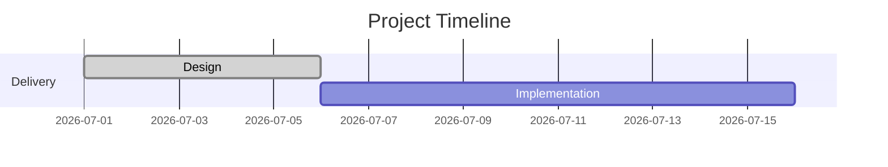

- In Gantt tasks, use `Label :id, start-or-after, duration`; with a status,
  use `Label :status, id, start-or-after, duration`.
- Only use the documented status keywords `done`, `active`, `crit`, and
  `milestone`. Do not invent status keywords. Without a status, the first field
  after `:` is the task ID.
- For dependencies, use `Label :id, after predecessor, duration`, or omit a new
  ID with `Label :after predecessor, duration`. Never write
  `:after predecessor, id, duration`; Mermaid treats `id` as a date and
  rendering fails.

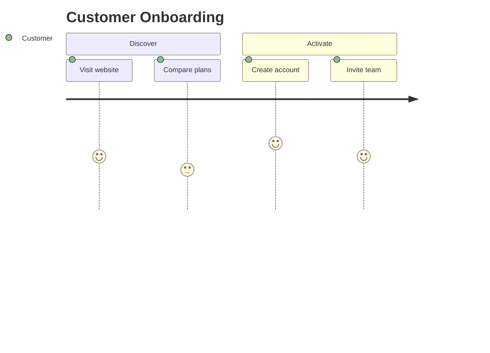

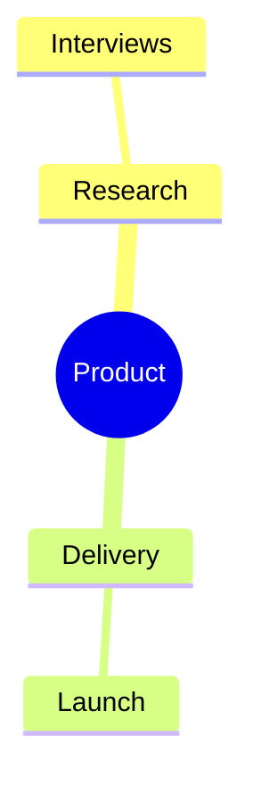

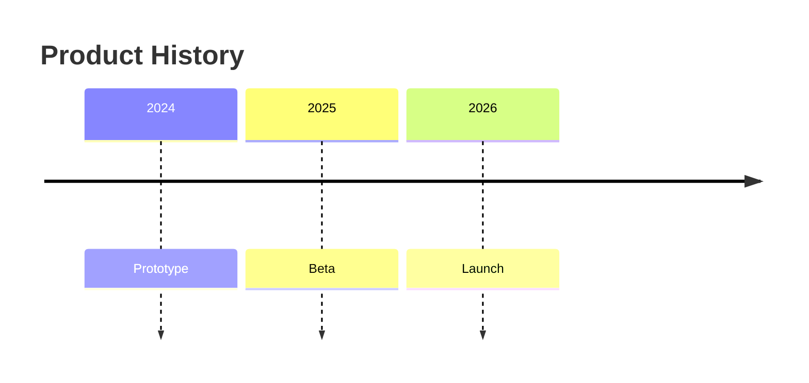

- Timeline period text before `:` must be one token. Dates such as `2026-07-15`
  and clock labels such as `02h47` are safe.
- Do not use `HH:MM`, a full timestamp, or any other colon inside a timeline
  period. Put the precise timestamp in the event text, or use a
  `sequenceDiagram` for sub-day chronology.

## Mermaid-Only Quantitative Charts

For quantitative Mermaid charts, adapt one of these templates. Do not invent
additional axis or series syntax.

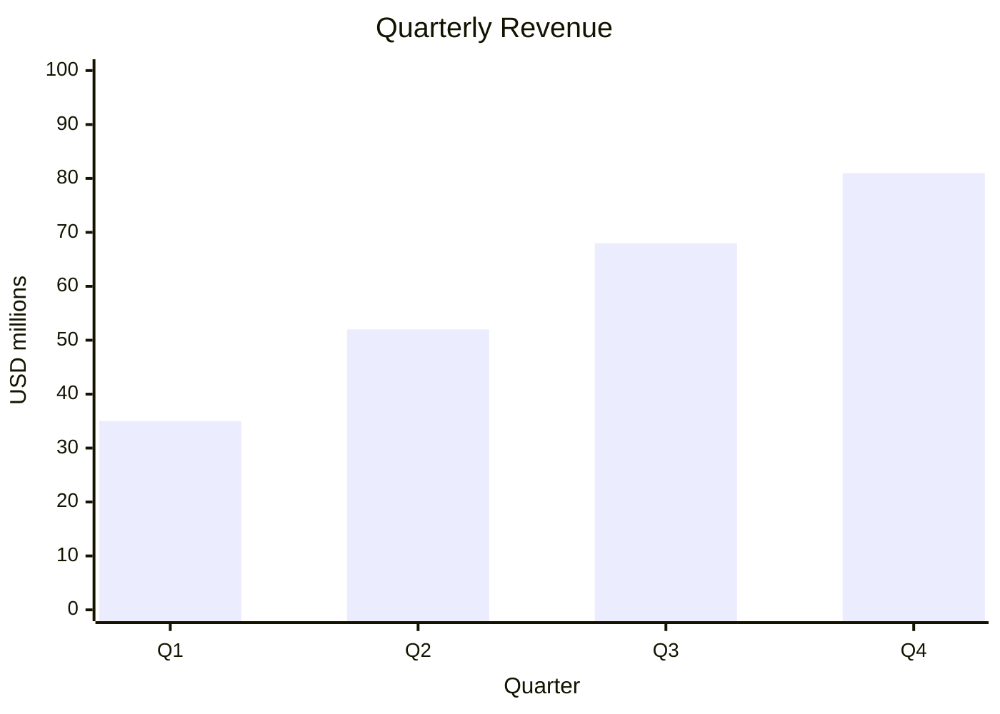

- Use exactly one `bar` or `line` series per block so its meaning is clear from
  the title or surrounding caption.
- Keep the title and axis labels in double quotes, especially when they contain
  punctuation.
- A series is exactly `bar [numbers]` or `line [numbers]`. Never put a series
  name or any other tokens after the closing bracket.
- The y-axis is a numeric range such as `0 --> 100`, never an array.
- Every series must have the same number of values as the categorical x-axis.

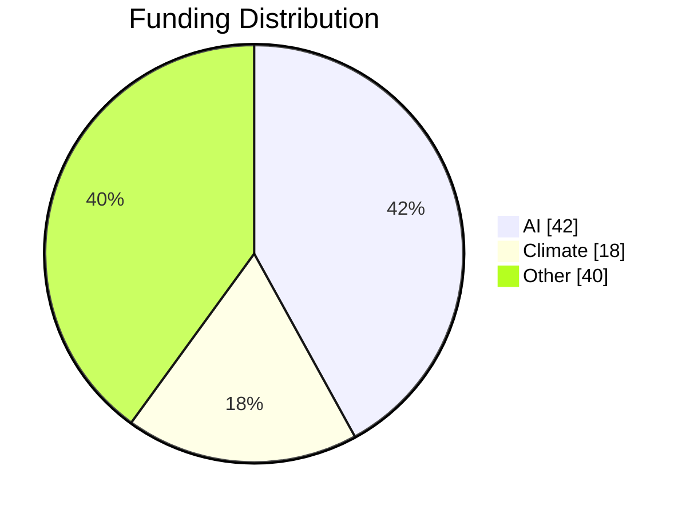

- Entries are quoted label/value pairs. `showData` belongs on the declaration
  line.

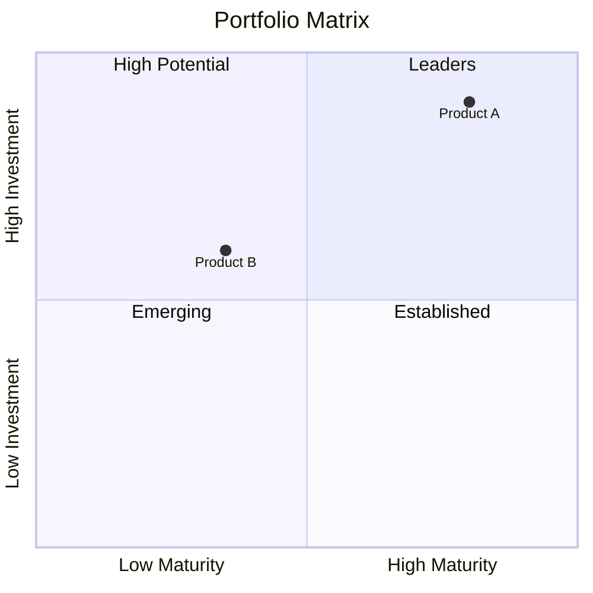

- Axis lines contain only their two endpoint labels separated by `-->`. Put any
  axis description in surrounding prose.
- Coordinates are numeric values from `0` to `1`.

## High-Risk Grammar

Sankey contains only its declaration followed immediately by CSV rows:

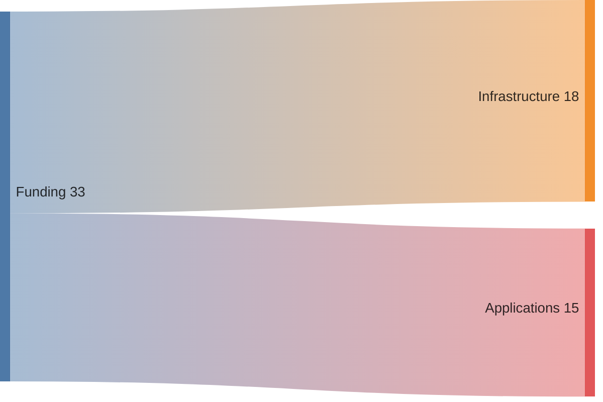

- Every row is exactly `Source,Target,Number`. Put the title outside the fence.
- Do not add a `title`, node declarations, brackets, arrows, or colon-valued
  edges to a Sankey block.
- `requirementDiagram` blocks contain only `id`, `text`, `risk`, and
  `verifymethod`. Quote values that need punctuation or spaces. Do not add
  `status`.
- C4 relationships use aliases declared earlier in the same block. Preserve
  exact function names such as `System_Ext` and `Deployment_Node`. Every
  `Deployment_Node(...)` opens a `{ ... }` body.
- Architecture edges reference the service ID before the icon parentheses. For
  `service api_gateway(internet)[API Gateway]`, connect `api_gateway`, not
  `internet`.
- Block diagrams declare blocks before connecting them. Use ordinary edges such
  as `client -- "HTTP" --> api`.
- Gantt is only for dates and durations. Never use task durations to represent
  market size, percentages, rankings, or other numeric magnitudes.
- Radar curves must have one value per declared axis.
- Indentation defines hierarchy in mindmaps, tree views, treemaps, and Ishikawa
  diagrams. Keep it consistent.

Before writing a specialized family, check every line against the grammar notes
above. If the syntax is uncertain, use a stable Mermaid family instead. Use raw
SVG only when the user's requested format allows it.

## Raw SVG

- Use raw SVG only, with a root `<svg>`, closing `</svg>`, and `viewBox`.
- Keep shapes, paths, definitions, masks, styles, and text inline.
- Do not use scripts, remote images, external stylesheets, or external fonts.
- When editing an existing SVG, change the specific element or attribute rather
  than rewriting unrelated content.
